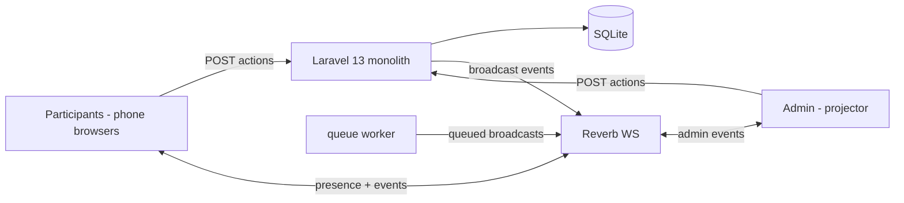

# Paradigm

**Single-writer monolith with broadcast.** One Laravel 13 process owns all state;
every mutation is an HTTP action that commits a transaction and then broadcasts
an event; the database is the only source of truth; Reverb relays, never stores.
Clients are Inertia/React views that render from server state and resync from a
full snapshot on any (re)connect. Flexibility is delivered by configuration (the
session config object), not by new code paths.

# Architecture decisions

## AD-1 Paradigm — single-writer monolith with broadcast [ADOPTED]
Binds: all state mutations run in the Laravel app via HTTP actions; SQLite is
the only source of truth; broadcasts fire only after committed mutations.
Prevents: client-side writes, divergent optimistic state, event-driven state drift.
Rule: no client persists anything except the device token and a cached render;
every mutation is a transaction, then a broadcast.

## AD-2 Stack — Laravel 13 monolith + Inertia 3 + React 19 [ADOPTED]
Binds: one Laravel app serves Inertia pages (server-rendered views with client
islands) and the actions; Vite builds the React client; PHP 8.3+; versions
pinned in Stack below.
Prevents: a separate API + SPA split, duplicated auth/session logic.
Rule: new code lands in the monolith; a second server app requires a new AD.

## AD-3 Identity — device token + session, no accounts [ADOPTED]
Binds: participant identity = participant_token (UUID in localStorage) +
display name + optional email; admin identity = per-session admin_token; no
users table, no login, no password reset.
Prevents: account-system creep, auth complexity, identity-verification expectations.
Rule: every session-scoped request is authorized by token (participant or
admin); tokens are bearer, revocable only by session delete/archive.

## AD-4 Session config object — single source of truth [ADOPTED]
Binds: rules (min/max, join mode, allow-creation, naming, freeze), fields,
permissions, and enabled extensions live in one validated config structure per
session; one resolver reads it.
Prevents: per-feature flags scattered across tables and code, divergent config storage.
Rule: adding a session-level setting = extending the config schema; feature
code never reads ad-hoc columns.

## AD-5 Permission resolution — centralized [ADOPTED]
Binds: can?(action, role, session) resolves session override → role default →
system default in one service; the same service emits the allowed-action set
the UI renders.
Prevents: duplicated checks in controllers and UI, dead buttons, privilege drift.
Rule: UI affordances render only from the server-computed allowed-action set;
the client never runs a second check.

## AD-6 Realtime — two channel classes, snapshot resync [ADOPTED]
Binds: a session presence channel (grid, pool, presence, flashes) and an admin
channel (god-mode events); events carry entity IDs + revision numbers; after
any (re)connect the client fetches the full session snapshot and renders from it.
Prevents: channel sprawl, stale UI after reconnect, per-feature channels.
Rule: reconnect always ends in a snapshot resync; flashes are derived
client-side from events and honor prefers-reduced-motion.

## AD-7 Membership model — seats [ADOPTED]
Binds: one participant row per (session, device token); memberships are rows
(participant, group, role leader/member, status pending/active); capacity =
count of active memberships, enforced transactionally with the freeze flag.
Prevents: double-joins, capacity races, seat reuse across devices.
Rule: join/leave/move/dissolve are single transactions that re-check capacity,
join mode, and freeze before committing.

## AD-8 Fields — config, not schema [ADOPTED]
Binds: field definitions live in the session config; values stored as JSON
keyed by field id; CSV export builds columns dynamically from config.
Prevents: a migration per field, rigid export columns.
Rule: adding a field is a config change only — no migration, no column.

## AD-9 Extensions — hooks + own data, never core mutation [ADOPTED]
Binds: extensions register listeners on session events, own screens, and own
namespaced tables; core (session/join/pool/grid/groups/admin/fields/
permissions) is extension-agnostic; taxonomy per flexibility-model.md
(Core / Extensions / Plugins; domains Communication, Formation, Trust, Data,
Event).
Prevents: core/extension coupling, core logic forked per feature.
Rule: enabling an extension on one session and not another is config-only;
core code cannot know an extension exists.

## AD-10 Operational envelope — one box, env-driven [ADOPTED]
Binds: Docker dev; Dokploy deploy at groupify.dxtechph.online; SQLite file DB;
database queue + one worker; Reverb on the same box; broadcast driver from env
(reverb default; pusher = swap).
Prevents: infra sprawl, paid external services, opaque deploys.
Rule: the app runs with one process + one queue worker + Reverb; nothing
external required; a failing dependency surfaces in the server-status UX, not a crash.

## AD-11 Server-status UX — visible degradation [ADOPTED]
Binds: offline banner driven by Reverb connection state plus a /health
heartbeat fallback; states online / reconnecting / offline; reconnect triggers
snapshot resync (AD-6).
Prevents: silent failure on a flaky home server.
Rule: every UI state is labeled online / reconnecting / offline; no unbounded spinners.

# Stack

| Name | Version |
|---|---|
| Laravel | ^13.25 (latest patch at build time) |
| PHP | ^8.3 |
| Inertia (React adapter) | ^3 |
| React | ^19 |
| Laravel Reverb | bundled with Laravel 13 (keep patched — CVE-2026-23524 class) |
| Tailwind CSS | ^4 |
| shadcn/ui | latest stable (Tailwind v4 compatible) |
| lucide-react | latest stable |
| SQLite | bundled (3.x) |
| Vite | latest stable (Laravel starter default) |

# Seed (cold-start shape; the code owns it once written)

Tables: `group_sessions` (code, pin, config JSON, status, timestamps — named to avoid the framework `sessions` table) ·
`participants` (session_id, token, name, email) · `groups` (session_id, name,
leader_id, field_values JSON) · `memberships` (participant_id, group_id, role,
status) · `session_events` (session_id, type, payload, at).
Channels: `session:<code>` (presence + events) · `admin:<code>` (god-mode).
Config JSON: `{ rules, fields[], perms, extensions[] }` where perms maps
action → role → on/off.

# Deferred (deliberately not decided here)

- Postgres migration mechanics — revisit when concurrent load or persistence needs exceed SQLite.
- Multi-session admin dashboard — phase 3.
- Offline resilience (CAP-14): PWA cache+sync vs local/mesh vs hybrid — needs its own design pass before any build.
- Retention/self-destruct policy (CAP-15) — defaults unresolved.
- Third-party plugin API beyond first-party extensions.
- Scaling beyond 200 concurrent (sharding, Redis).
- Async-session reopen semantics, avatar/spatial engagement modes (roadmap phase 3).
