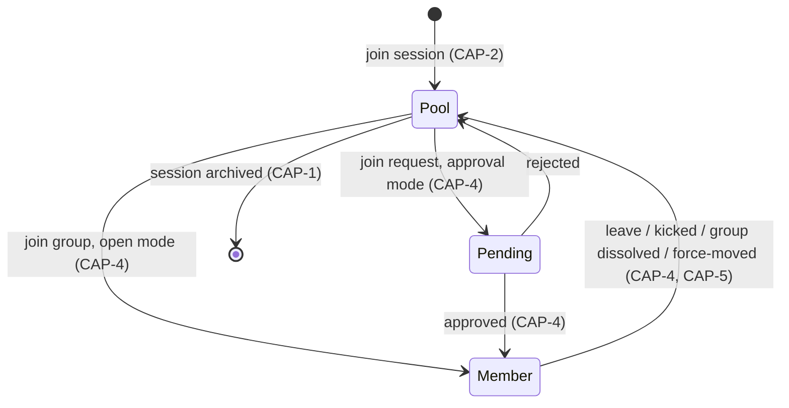

# Groupify — State Machines

## Participant state



```
        join            approve
  ┌──────────┐   ┌──────────┐   ┌──────────┐
  │  POOL    ├──►│ PENDING  ├──►│ MEMBER   │
  │ (unass.) │   │ (queue)  │   │ (group)  │
  └──────────┘   └──────────┘   └────┬─────┘
     ▲    ▲       reject ▲           │ leave/kick
     │    └──────────────┘           │ dissolve
     └───────────────────────────────┘
        (auto-rejoin via device token = same seat)
```

Invariants:
- A device token maps to exactly one seat per session (CAP-2).
- Pending exists only when session join mode is `approval` (CAP-4, CAP-7).
- Leaving, being kicked, group dissolve, and force-move all land in Pool; no other exit.

## Session lifecycle

```
DRAFT ──create──► LIVE ──freeze──► FROZEN ──unfreeze──► LIVE
                    │                  │
                    └──────archive / delete──────────► ARCHIVED
```

- LIVE: joins and membership changes allowed per session rules.
- FROZEN: joins, leaves, and swaps locked; board read-only; admin may still dissolve (CAP-5).
- ARCHIVED: no joins; data retained per retention policy (CAP-15); export still available.

## Group lifecycle

```
CREATED ──first member──► OPEN ──capacity reached──► FULL
   │                        │  │                       │
   │                        │  └─slots freed──► OPEN   │
   └──(leader inactive, ghost)──► ownership transfer or revert to open join (CAP-10)
   FULL ──leave──► OPEN ──dissolve / zero members──► DISSOLVED
```

- Sequential naming: Team Alpha/Bravo… or Table 1/2… per session config (CAP-4).
- Ghost-group GC and ownership transfer are CAP-10 (deferred), not night-one.
